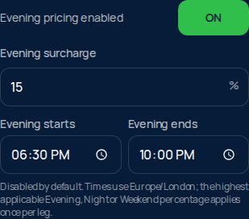

# Quote recovery and configurable evening pricing

Prepared 23 October 2026 on `codex/fix-quote-calculating`, based on main `7c142d3`.

**Local changes only. No push, merge, deployment, live pricing edit, booking or payment was made for this fix.** Deployment requires the owner's approval.

## Findings

The indefinite-loading defect is confirmed: `/pricing/public` and `/quote/calculate` had no request deadline, including no deadline while reading a response body. QuoteCard waits for public pricing before starting an authoritative fare. A stalled request could therefore leave the card showing “Calculating…” forever. Its existing failure/retry UI only became reachable after a promise actually settled.

An isolated browser test against the previous production export reproduced a stalled fare remaining pending after 22 seconds with no Retry control. The originally reported production outage did not recur during live investigation, so the precise upstream trigger for that incident is not established.

The supplied City Hall → Belfast International journey completed in the live browser at **£60**, and the reverse at **£61**, for one Saloon passenger and one suitcase on 24 October 2026 at 09:59. These are observed customer totals. The backend's raw transfer amounts exclude the separately added Belfast Express access charge and precede final customer rounding.

The £45 Belfast International minimum is configured and applied after the normal base vehicle fare. It does not replace a higher normal fare. It remains before applicable per-leg surcharges, return discounts and airport access. No regression was found in that floor; the arithmetic is unchanged by this fix.

The night-rate issue was reproduced as misleading text: quote breakdowns and booking messages contained a hardcoded 10% label. Live config version 225 initially contained 25%; version 226, saved at 09:08:18 UTC during the investigation, contained **20%** for 22:00–06:00. We did not make that settings change. A live 23:00 quote applied £10 to a £50 base, confirming the then-current 20% rate. Tests also verify configured 25% and 37.5% rates. The existing highest-applicable rule already handles Night/Weekend overlaps; these are not added together.

## Trace and live diagnostics

The static frontend is served on myairporttaxini.co.uk; its quote endpoint is the Cloudflare Worker `reimagined-octo-meme.cgr28.workers.dev`. Vercel is not the runtime for this quote API.

The traced path is address selection → public pricing → QuoteCard authoritative request → Worker pricing/booking settings → airport inference from addresses → server route resolution → OSRM road distance → pricing formula/£45 BFS floor → per-leg surcharge/discount → response → customer access charges and rounding. Payment separately verifies the authoritative amount before SumUp.

Public address lookup resolved City Hall to a valid Google place and coordinates. All six direct live quote requests below returned HTTP 200 with positive road metrics and correct airport/direction detection. No distance was supplied in those requests; the Worker resolved it. Responses took about 4–6 seconds from this environment, with route/config/fare stage totals below one second on the recorded six-request sample.

| Journey | Road km | Reported miles | Worker amount, before Belfast Express access |
| --- | ---: | ---: | ---: |
| City Hall → Belfast International | 25.83 | 16.1 | £55.00 |
| Belfast International → City Hall | 26.16 | 16.3 | £56.10 |
| City Hall → Belfast City | 7.40 | 4.6 | £33.00 |
| Belfast City → City Hall | 5.30 | 3.3 | £33.00 |
| City Hall → Dublin | 158.73 | 98.6 | £286.70 |
| Dublin → City Hall | 159.18 | 98.9 | £291.70 |

Live browser console inspection showed no application errors for the successful reproduction. The public settings and route requests succeeded; no failed production quote request was captured. Vercel's recent error/warning/fatal log query returned no entries. Cloudflare log streaming was blocked by the absence of a Cloudflare API token. Consequently, historical Worker failures and secret configuration could not be inspected directly. Successful place resolution and quotes demonstrate that the tested routing path was operational, not that every environment variable is present. Existing missing-receipt-secret behaviour is covered by signed and unsigned payment tests.

## Changes

- Pricing settings have a 10-second deadline; fare calculation has a 20-second total deadline across its existing retry. Both deadlines include JSON body reads, propagate cancellation, and release timers/listeners. A timeout differs from an intentional cancellation when the customer changes inputs.
- The quote flow treats failed or invalid settings as a recoverable error. It never paints default pricing as an authoritative fare. Try again refetches settings when necessary, or retries the fare. Routing failure never produces an invented distance or fare.
- The existing quote card and Try again styling are reused. Booking and payment controls remain unavailable until a valid current fare exists.
- Evening pricing adds an enable switch, percentage and editable start/end times to the existing owner dashboard. It is **disabled with a 0% rate by default**, with editable placeholder hours of 18:00–22:00. No evening tariff has been enabled in production.
- Evening uses Europe/London wall-clock time, start-inclusive/end-exclusive windows, midnight wrapping, and the highest applicable Evening/Night/Weekend rate per leg. Fixed airport charges are excluded; return discounts keep their existing order.
- Evening settings validate, persist, appear in the public config/audit, and survive saves from older clients that omit the field.
- The Worker returns surcharge copy from the same settings snapshot as the calculated fare. The frontend carries that copy with the fare, so stale public settings cannot relabel a newer quote. Booking messages that lack a historical rate use a generic surcharge description instead of asserting 10%.

## Modified files

| Files | Purpose |
| --- | --- |
| `src/lib/request-deadline.ts` | Shared deadline and cancellation helper (new). |
| `src/lib/quick-quote-api.ts`, `src/lib/owner-pricing-api.ts` | Bound requests, reject unusable quote settings, retain authoritative surcharge text. |
| `src/components/QuoteCard.tsx`, `src/lib/quote-display-fare.ts` | Recover loading failures, retry config/fare, associate copy with the current fare. |
| `shared/owner-pricing-config.ts`, `src/lib/point-to-point-premium.ts` | Evening validation/defaults/audit/public config, configured time windows and copy. |
| `src/components/OwnerPricingPanel.tsx` | Evening controls within the existing pricing dashboard. |
| `workers/addresses/src/owner-pricing-store.ts`, `workers/addresses/src/quote-handlers.ts` | Preserve evening values for older clients; return authoritative surcharge text. |
| `shared/website-fare-breakdown.ts`, `src/components/QuoteFareTrust.tsx` | Render configured surcharge labels/explanations without changing totals. |
| `shared/website-promo-pricing.ts`, `src/lib/booking-message.ts` | Remove misleading hardcoded 10% from persisted-booking wording. |
| `workers/addresses/shared/{owner-pricing-config,website-fare-breakdown,website-promo-pricing}.ts` | Generated mirrors of changed shared modules. |
| `scripts/check-quote-request-deadline.ts`, `scripts/check-quote-request-recovery-browser.mjs`, `scripts/check-evening-night-pricing.ts` | New failure/recovery, dashboard and pricing/payment tests. |
| `scripts/check-night-weekend-surcharge.ts`, `scripts/check-quote-schedule-price-gate.ts` | Replace obsolete hardcoded-copy assertions with checks for configured copy. |
| `package.json` | Commands for the new request and evening/night suites. |
| This report and `docs/quote-recovery-review/*.png` | Findings and local review evidence. |

## Validation

- Frontend static export: `GITHUB_PAGES=true npm run build` — passed, 149 pages.
- TypeScript: `node node_modules/typescript/bin/tsc --noEmit` — passed.
- Lint: `npm run lint` — passed with existing warnings.
- Worker: `npm --prefix workers/addresses run build` — passed typecheck and **dry-run only**, no deployment.
- `git diff --check` — passed.
- 15 regression suites passed: request deadlines, evening/night pricing, BFS minimum, BFS payment, night/weekend surcharge, authoritative fare, schedule gate, required fields, vehicle refresh, quote-path parity, payment place resolution, owner pricing, airport-to-airport pricing, signed receipts, and Meet & Greet payment.
- New deadline suite: 12 scenarios covering stalls before headers and during body reads, routing/network failure, retry, cancellation, malformed settings and recovery.
- Evening/night suite: 38 boundary/percentage/persistence assertions plus 24 real quote-handler → mocked SumUp cases across BFS/BHD/DUB, both directions and one-way/return.
- Existing BFS floor suite: 246 assertions. Existing payment suites: 192 BFS cases and 384 Meet & Greet cases. Together with the new suite, **600 mocked quote/payment cases** passed. No real payment or email was sent.
- Chromium production-export tests: settings timeout, fare timeout, routing failure, retry recovery, reverse journey, authoritative 20% night text overriding stale default text, and evening/night dashboard save/reload. Mobile quote checks at 390 px; success case at 1280 px. External requests intercepted; no live writes or page exceptions in passing scenarios.
- Baseline browser failure reproduced before the fix; the fixed browser shows the existing error and retry UI.
- WebKit could not run: required system libraries are missing, and the runtime rejected package installation. Safari verification remains outstanding.

Useful local commands:

```sh
npm run check:quote-request-recovery
npm run check:evening-night-pricing
node --import tsx scripts/check-quote-request-recovery-browser.mjs
```

The browser script requires Playwright and an installed browser, as do the repository's other browser checks. `PLAYWRIGHT_MODULE`, `PLAYWRIGHT_BROWSER`, and `CHROMIUM_EXECUTABLE_PATH` can select an existing installation.

## Review images

Existing quote card after a simulated stalled request:


Evening controls after saving/reloading **isolated test settings** (15%, 18:30–22:00). The shipped default remains disabled at 0%:



## Approval boundary

These changes are committed locally for review. They have not been pushed because repository pushes can trigger Vercel previews, and the instruction was not to deploy without approval. Production settings, configured discounts, the £45 floor, booking data and SumUp configuration are unchanged. On approval, publish the change and deploy the frontend and Worker together, then repeat the live journey and configured night/evening checks.
